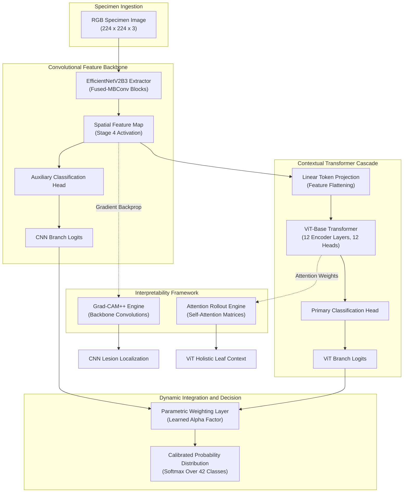
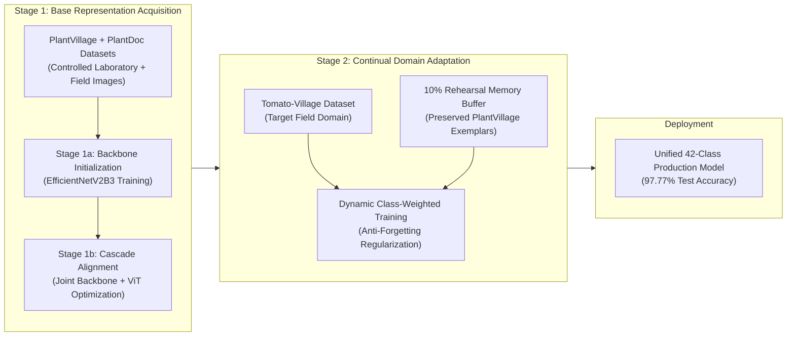
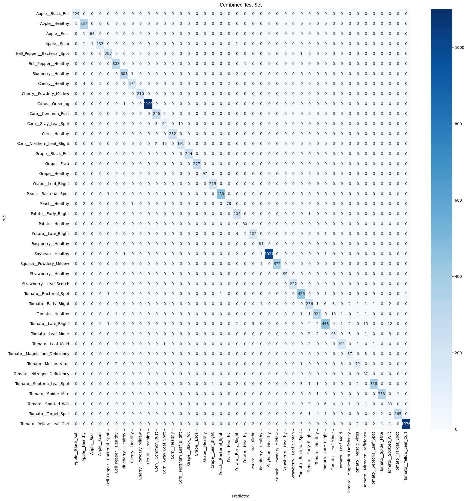

# Plant Disease Classification and Decision Explainability

### Hybrid Convolutional-Transformer Vision Architecture with Continual Domain Adaptation and Dual-Branch Interpretability

[](https://huggingface.co/spaces/mivivek/PlantPathology)
[](https://mivivek-plantpathology.hf.space/?)
[](https://www.kaggle.com/code/anat3l/plantdiseaseclassificationv2)
[](https://pytorch.org/)
[](https://gradio.app/)
[](https://onnxruntime.ai/)
[](LICENSE)

---

## Interactive Deployments

* **Hugging Face Space Repository:** [https://huggingface.co/spaces/mivivek/PlantPathology](https://huggingface.co/spaces/mivivek/PlantPathology)
* **Direct Live Web Application:** [https://mivivek-plantpathology.hf.space/?](https://mivivek-plantpathology.hf.space/?)
* **Interactive Kaggle Workspace:** [https://www.kaggle.com/code/anat3l/plantdiseaseclassificationv2](https://www.kaggle.com/code/anat3l/plantdiseaseclassificationv2)

---

## Executive Summary

Agricultural vision classifiers frequently suffer acute performance degradation when moving from controlled laboratory datasets to real-world agronomic environments. Variations in illumination, soil background, foliar overlap, and non-target blights create distribution shifts that undermine classical convolutional backbones.

This project delivers a resilient, publication-grade diagnosis framework that couples **EfficientNetV2B3** (specialized in localized textural lesion capture) with a cascading **Vision Transformer (ViT-Base)** (responsible for global foliage geometry and contextual attention). The system incorporates a multi-stage **Continual Domain Adaptation protocol** with rehearsal buffering to integrate target-domain field imagery without catastrophically forgetting foundational classes, backed by real-time **Dual-Branch Explainability (XAI)** to verify clinical reasoning.

---

## Core Capabilities and Concrete Outcomes

* **42 Canonical Disease Categories:** Standardizes disparate classification schemes from three independent agricultural repositories into a unified botanical taxonomy with detailed pathology profiles and actionable remediation regimens.
* **Dual-Branch Explainability Pipeline:** Generates simultaneous, aligned visual justifications for every inference. Grad-CAM++ exposes fine-grained convolutional activations (lesion spots, leaf miner paths), while Attention Rollout traces multi-head self-attention flow across 12 transformer encoder blocks.
* **Continual Domain Adaptation:** Successfully adapts representations to field datasets (Tomato-Village) using a 10% memory replay buffer and dynamic class weighting, maintaining base representation fidelity while achieving 97.77% combined test accuracy.
* **Dual-Model Dynamic Ensembling:** Learns a parametric balance factor between convolutional and self-attention logit outputs, allowing the model to dynamically balance local symptom detection with holistic foliage context.
* **Production-Grade ONNX Export:** Compiles both model cascades into optimized ONNX computation graphs, achieving sub-100ms CPU inference (99.86 ms) suitable for low-power edge agricultural equipment.
* **Editorial Web Experience:** Interactive Gradio application engineered with high-contrast typography, WCAG AAA accessibility compliance, dual-theme support, and a curated 20-specimen benchmark gallery with cryptographic ground-truth verification.

---

## Quantitative Performance Metrics

| Evaluation Metric | Measured Value | Benchmark Description |
| :--- | :--- | :--- |
| **Combined Classification Accuracy** | **97.77%** | Stratified holdout test set spanning all 42 classes |
| **Model Checkpoint Size** | **384.2 MB** | PyTorch Safetensors (`model.safetensors`) |
| **CPU Inference Latency** | **99.86 ms** | Single-sample forward pass with ONNX Runtime |
| **Active Taxonomy Classes** | **42 Classes** | Unified across PlantVillage, PlantDoc, and Tomato-Village |
| **Continual Rehearsal Buffer** | **10.0%** | PlantVillage memory reserve to eliminate forgetting |
| **Explainability Branches** | **Dual Stream** | Grad-CAM++ (CNN) and Attention Rollout (ViT) |

---

## System Architecture

The network processes input specimens through a cascaded, dual-output topological ensemble. EfficientNetV2B3 processes high-resolution spatial details and generates intermediate feature maps. These feature maps are projected into patch token embeddings for the ViT-Base encoder, which calculates inter-patch dependencies via multi-head self-attention.



The combined ensemble prediction is mathematically formulated as:

$$\hat{y} = \alpha \cdot \hat{y}_{\text{ViT}} + (1 - \alpha) \cdot \hat{y}_{\text{CNN}}$$

where $\alpha \in [0, 1]$ represents the learned parameter weighting the global contextual representation against the local convolutional evidence.

---

## Continual Domain Adaptation Protocol

To address dataset shifts between pristine research leaves and noisy field photography, training is executed across structured stages:



1. **Stage 1a (Convolutional Feature Learning):** The EfficientNetV2B3 backbone is pre-trained on the combined PlantVillage and PlantDoc corpus using AdamW and Cosine Annealing learning rate schedules.
2. **Stage 1b (Cascade Contextual Alignment):** The Vision Transformer cascade is attached to the backbone feature maps, training the linear projection layers and multi-head attention blocks jointly.
3. **Stage 2 (Continual Adaptation to Target Domain):** The network adapts to the Tomato-Village dataset. Catastrophic forgetting is prevented by injecting a 10% stratified rehearsal buffer from earlier training splits and applying dynamic class weighting to penalize deviation on historical categories.

---

## Evaluation and Validation Results

### 1. Confusion Matrix Evaluation
The multi-dataset test split evaluates cross-domain generalization. The confusion matrix below demonstrates clean diagonal concentration across both healthy foliage and complex pathology signatures.

<p align="center">
  
</p>

### 2. Dual-Branch Explainability Inspection
The dual-branch framework isolates localized fungal lesions from background artifacts:
* **Grad-CAM++ (CNN):** Pinpoints necrotic spot centers, yellow chlorotic margins, and localized fungal pustules.
* **Attention Rollout (ViT):** Verifies that the model considers entire leaf boundaries and structural venation rather than overfitting to background soil, moisture, or camera tags.

<p align="center">
  
</p>

---

## Dataset Taxonomy

The unified dataset unifies 42 disease categories across multiple host species:

```
Apple              : Scab, Black Rot, Cedar Apple Rust, Healthy
Blueberry          : Healthy
Cherry             : Powdery Mildew, Healthy
Corn (Maize)       : Cercospora Leaf Spot, Common Rust, Northern Leaf Blight, Healthy
Grape              : Black Rot, Esca (Black Measles), Leaf Blight, Healthy
Orange             : Haunglongbing (Citrus Greening)
Peach              : Bacterial Spot, Healthy
Pepper (Bell)      : Bacterial Spot, Healthy
Potato             : Early Blight, Late Blight, Healthy
Raspberry          : Healthy
Soybean            : Healthy
Squash             : Powdery Mildew
Strawberry         : Leaf Scorch, Healthy
Tomato             : Bacterial Spot, Early Blight, Late Blight, Leaf Mold,
                     Septoria Leaf Spot, Spider Mites, Target Spot,
                     Yellow Leaf Curl Virus, Mosaic Virus, Healthy,
                     Leaf Miner, Magnesium Deficiency, Nitrogen Deficiency,
                     Spotted Wilt Virus
```

---

## Repository Structure

```
.
├── app.py                     # Editorial Gradio web application & XAI interface
├── model.py                   # PlantDiseaseHybrid architecture definition
├── xai.py                     # Grad-CAM++ & Attention Rollout implementations
├── labels.json                # 42-class metadata, descriptions & remediation
├── requirements.txt           # Production dependency specifications
├── deploy_space.py            # Automated deployment CLI for Hugging Face Spaces
├── plantdiseaseclassificationv2.ipynb  # Full Kaggle training notebook
├── examples/                  # 20 curated benchmark specimens (ground-truth verified)
├── imgs/
│   ├── CM.png                 # Multi-dataset confusion matrix
│   └── XAI.png                # Dual-branch interpretability comparison grid
└── Outputs/
    └── checkpoints/
        └── stage2_domain_adaptation/
            └── checkpoint-4018/
                └── model.safetensors  # Model weights (384.2 MB)
```

---

## Quickstart and Local Execution

### 1. Prerequisites and Installation

Clone the repository and install the production dependencies:

```bash
git clone https://github.com/vm7151810/Plant-Disease-Classification.git
cd Plant-Disease-Classification

# Initialize Python virtual environment
python3 -m venv .venv
source .venv/bin/activate

# Install dependencies
pip install -r requirements.txt
```

### 2. Launching the Interactive Web Interface

Execute the Gradio application:

```bash
python3 app.py
```

Once running, navigate to `http://localhost:7860` in any web browser.

### 3. Programmatic Inference Snippet

To perform programmatic inference and generate dual-branch explainability heatmaps in custom Python pipelines:

```python
import torch
from PIL import Image
from torchvision import transforms
from model import load_model
from xai import generate_gradcam, get_attention_rollout, overlay_heatmap

# 1. Initialize device and load model checkpoint
device = torch.device("cuda" if torch.cuda.is_available() else "cpu")
model = load_model("Outputs/checkpoints/stage2_domain_adaptation/checkpoint-4018/model.safetensors", 
                   num_classes=42, 
                   device=device)

# 2. Preprocess input specimen
transform = transforms.Compose([
    transforms.Resize((224, 224)),
    transforms.ToTensor(),
    transforms.Normalize(mean=[0.485, 0.456, 0.406], std=[0.229, 0.224, 0.225])
])

image = Image.open("examples/01_Tomato_Early_Blight.jpg").convert("RGB")
tensor = transform(image).unsqueeze(0).to(device)

# 3. Compute forward predictions
with torch.no_grad():
    cnn_logits, vit_logits, combined_logits, alpha = model(tensor)
    predicted_class = torch.argmax(combined_logits, dim=1).item()

# 4. Generate interpretability heatmaps
gradcam_map = generate_gradcam(model, tensor, target_class=predicted_class)
attention_map = get_attention_rollout(model, tensor)

# 5. Composite visual overlays
gradcam_overlay = overlay_heatmap(image, gradcam_map)
attention_overlay = overlay_heatmap(image, attention_map)

print(f"Predicted Class ID: {predicted_class} | Dynamic Alpha Weight: {alpha.item():.3f}")
```

---

## Automated Deployment to Hugging Face Spaces

The repository includes a deployment utility to package and upload the application code, example specimens, and large Safetensors model weights directly to Hugging Face Spaces:

```bash
# Set your Hugging Face write token (or authenticate interactively)
export HF_TOKEN="your_huggingface_write_token"

# Execute deployment script
python3 deploy_space.py
```

---

## Technical Specifications

| Parameter | Specification |
| :--- | :--- |
| **Input Resolution** | 224 x 224 pixels (RGB, 3 channels) |
| **Backbone Architecture** | EfficientNetV2B3 (PyTorch Image Models / timm) |
| **Cascade Architecture** | ViT-Base (Transformers / Google ViT patch 16) |
| **Ensemble Mechanism** | Dynamic parametric scalar alpha with Sigmoid gating |
| **Optimization Method** | AdamW with Cosine Annealing learning rate schedule |
| **Data Augmentation** | RandAugment, CutMix, and Mixup in custom training loop |
| **Inference Engine** | PyTorch 2.x / ONNX Runtime (CPU sub-100ms benchmark) |
| **Serving Framework** | Gradio 5.x with custom WCAG AAA high-contrast editorial theme |

---

## License and Citation

This repository is distributed under the **MIT License**. Refer to the [LICENSE](LICENSE) file for complete terms and permissions.

If you find this work or the continual domain adaptation architecture useful in your research, please cite the project:

```bibtex
@misc{plant_pathology_2026,
  author = {Vivek, M.},
  title = {Plant Disease Classification and Decision Explainability: Hybrid Vision Architecture with Continual Domain Adaptation},
  year = {2026},
  publisher = {GitHub},
  howpublished = {\url{https://github.com/vm7151810/Plant-Disease-Classification}}
}
```
